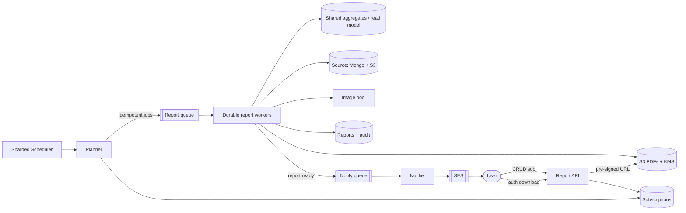

# Florence Healthcare — Automated Report Feature: System Design

Design submission for the automated weekly reporting feature.

> **Written summary (the required deliverable) is below.** Diagrams, APIs,
> alternatives, and the reliability/compliance detail are in [`docs/`](docs/).

---

## Written summary

**Problem.** Add an automated reporting feature: a long-running process
aggregates tabular data (Mongo `Documents`) and files/images (S3), does complex
image processing, compiles a PDF, and emails it to subscribed users on a weekly
interval — for a very large, heavily-used user base.

**Core insight.** This is not a request/response feature. It is a **scheduled,
fan-out, long-running, compute-heavy batch pipeline** with a compliance-sensitive
delivery tail. The design therefore centres on three things:

1. **Decoupling** — the schedule, the compute, and the delivery are separate
   planes that scale and fail independently, connected by queues.
2. **Idempotent, resumable steps** — at-least-once transport + idempotency keys +
   durable execution, so nothing is silently stuck or double-sent.
3. **Controlled fan-out** — a sharded schedule, shared incremental aggregation,
   and autoscaling-on-queue-depth so a weekly tick doesn't stampede the DB or the
   email quota.

**Solution in one flow.** Users subscribe via the API. A **sharded scheduler**
ticks; a **planner** enumerates due subscriptions and enqueues one idempotent job
per report. **Durable workers** read a pre-computed aggregate (CQRS read model),
fetch and process images (separate autoscaled pool, content-hash cached), render
the PDF, store it in S3 with KMS, write status + an append-only audit record, and
emit `report.ready`. A **notification worker** emails a **secure, authenticated,
time-limited link** — never the PHI PDF itself — via SES. The user logs in and
downloads via a short-TTL pre-signed URL, and that access is audited.

**Why this fits Florence specifically.** Regulated clinical-trial data means
21 CFR Part 11 / GxP audit trails, HIPAA-safe delivery (link not attachment), and
**data residency** — so generation, storage, and audit are per-region while the
control plane stays global. Long-running, must-not-double-process journeys are
exactly what durable execution is for.

**Key tradeoffs I made deliberately** (full list in [docs/04](docs/04-alternatives-and-tradeoffs.md)):
container workers + durable execution over Lambda (15-min cap vs minutes-long
image jobs); shared incremental aggregation over per-user recompute (cost at
scale); secure link over PDF attachment (compliance); sharded schedule over a
single global cron (avoid the weekly stampede).

---

## Top-level architecture

---

## Repo guide

| Doc | What's in it |
|-----|--------------|
| [`docs/01-questions-and-assumptions.md`](docs/01-questions-and-assumptions.md) | Clarifying questions I'd ask + documented assumptions |
| [`docs/02-architecture.md`](docs/02-architecture.md) | C4 diagrams, components, sequences, state machine, residency view |
| [`docs/03-api-and-data-model.md`](docs/03-api-and-data-model.md) | New/amended APIs, event contracts, data model |
| [`docs/04-alternatives-and-tradeoffs.md`](docs/04-alternatives-and-tradeoffs.md) | Options considered, decisions, other scenarios |
| [`docs/05-reliability-scale-compliance.md`](docs/05-reliability-scale-compliance.md) | Idempotency, failure handling, scale, security, 21 CFR Part 11 |
| [`docs/06-interview-walkthrough.md`](docs/06-interview-walkthrough.md) | Spoken walkthrough script + anticipated Q&A |

## Assumptions (short version)
Large scale (~500k subs, weekly); personalised reports sharing common study
aggregates; minutes-long image-heavy jobs; PHI present ? secure-link delivery;
21 CFR Part 11 audit; region is a boundary; AWS-native but transport-agnostic.
Full rationale in [docs/01](docs/01-questions-and-assumptions.md).

## Time taken
_~Xh total — replace with your actual number before submitting (they ask for it)._
