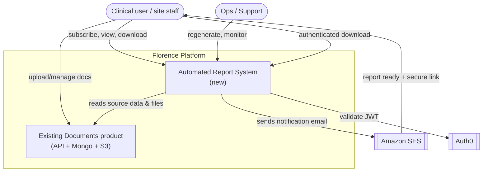
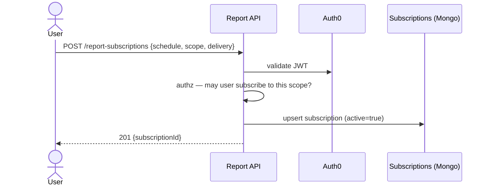
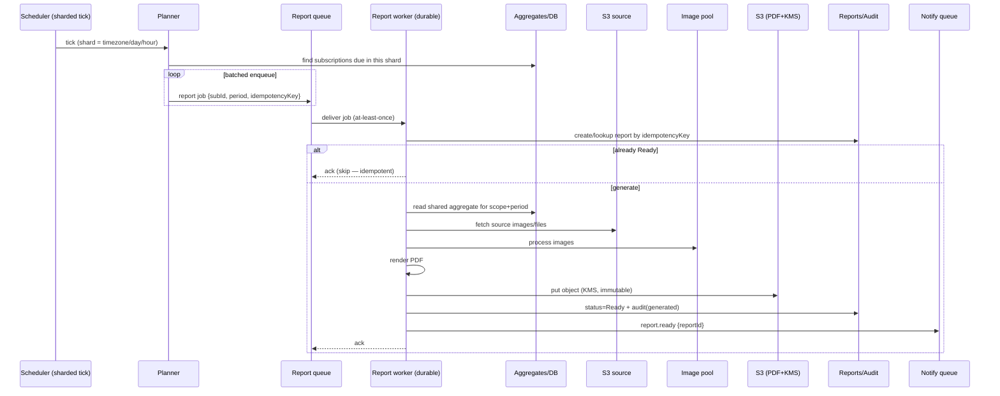
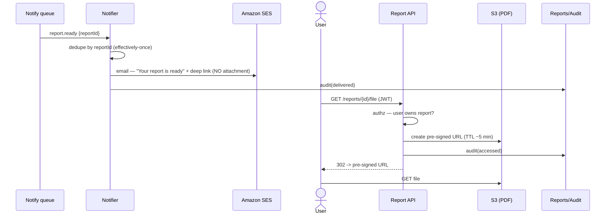
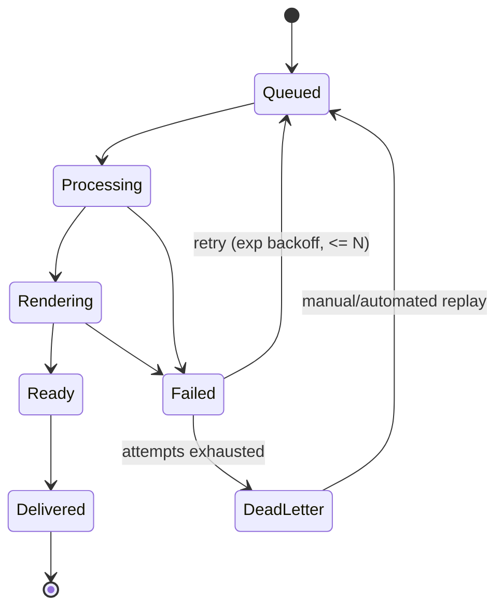
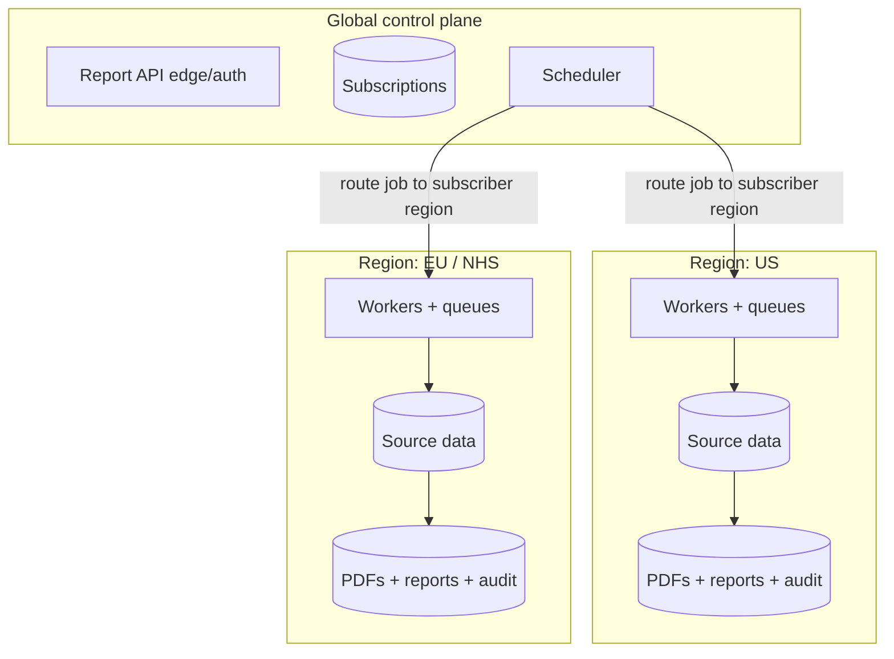

# Architecture — Automated Weekly Report Feature

## The one-sentence framing

This is **not** a request/response feature. It is a **scheduled, fan-out,
long-running, compute-heavy batch pipeline** with a compliance/delivery tail.
So the whole design is about *decoupling* the schedule from the compute from the
delivery, making every step **idempotent and resumable**, and controlling the
**fan-out** so a weekly tick doesn't stampede the datastores and the email quota.

## Design principles (the "why" I'll defend in the room)

1. **Decouple via a queue.** The API never generates a report inline. A tick
   enqueues work; workers drain it. This is what lets reads/writes, compute, and
   delivery scale and fail independently.
2. **Split into planes** with different scaling and failure profiles:
   - **Control plane** — subscriptions + scheduling (small, transactional).
   - **Compute plane** — report generation (bursty, CPU-heavy, long-running).
   - **Delivery plane** — email + secure download (throughput-limited by SES + auth).
   - **Audit/storage plane** — immutable trail + PDF store (regulated).
3. **Idempotency everywhere.** At-least-once transport means every step can
   re-run. Keyed side effects (`hash(subscriptionId, period)`) ? effectively-once.
4. **Durable, multi-step generation.** A report is a small workflow (aggregate ?
   fetch ? process ? render ? store ? notify). Model it so it *resumes* after a
   crash/deploy instead of restarting or getting stuck.
5. **Compute the expensive thing once.** Maintain shared study aggregates
   incrementally (CQRS read model); the per-report step is cheap assembly, not a
   full weekly recompute.
6. **Spread the load.** Shard the weekly schedule across the interval so peak ? average.
7. **Compliance is a design input, not a wrapper.** Audit, residency, and
   "no PHI in email" shape the boxes, not a checkbox at the end.

---

## C4 — Level 1: System context



---

## C4 — Level 2: Component / container view

```mermaid
flowchart LR
  U([User / Browser])

  subgraph CP["Control plane (global)"]
    API["Report API<br/>NestJS"]
    SUBDB[("Subscriptions<br/>MongoDB")]
    SCH["EventBridge Scheduler<br/>(cron, sharded)"]
    PLN["Planner / Enumerator<br/>(finds due subs, batches)"]
  end

  subgraph Q1[" "]
    Q[["Report job queue<br/>SQS / Kafka topic"]]
    DLQ[["Dead-letter queue"]]
  end

  subgraph COMP["Compute plane (per-region)"]
    W["Report Workers<br/>ECS/EKS + durable execution"]
    IMG["Image-processing pool<br/>(CPU/GPU, autoscaled)"]
    AGG[("Shared aggregates /<br/>read model")]
  end

  subgraph DATA["Data & storage (per-region)"]
    SRC[("Source data:<br/>Documents (Mongo) + S3 files")]
    PDF[("Report PDFs<br/>S3 + KMS")]
    RDB[("Reports + Audit<br/>Mongo / Postgres")]
  end

  subgraph DEL["Delivery plane"]
    NQ[["Notify queue"]]
    N["Notification worker"]
    SES[[Amazon SES]]
    SNS["SES events via SNS<br/>(bounce/complaint)"]
  end

  U -->|CRUD subscription| API --> SUBDB
  U -->|list/status/download| API
  SCH --> PLN
  PLN -->|reads due| SUBDB
  PLN -->|enqueue jobs (idempotent)| Q
  Q --> W
  Q -. poison .-> DLQ
  W --> AGG
  W --> SRC
  W --> IMG
  W -->|upload PDF| PDF
  W -->|status + audit| RDB
  W -->|report.ready| NQ
  NQ --> N --> SES --> U
  SES --> SNS --> N
  API -->|pre-signed URL| PDF
  API -->|audit access| RDB
```

**Component responsibilities**

| Component | Responsibility | Notes |
|-----------|----------------|-------|
| **Report API (NestJS)** | Subscription CRUD; report listing/status; authenticated download; on-demand generate. | Thin, transactional. No heavy work inline. |
| **EventBridge Scheduler** | Fires cron ticks, **sharded** by day/hour/timezone. | Managed cron; avoids a single global stampede. |
| **Planner** | On a tick, enumerates *due* subscriptions and enqueues one job per report, **in batches**, with an idempotency key. | Separates "who is due" from "do the work". |
| **Report job queue** | Buffers work; provides backpressure; enables autoscaling on depth/lag. | SQS (AWS-native) or Kafka (Florence uses it). |
| **Report workers** | Durable multi-step workflow per report: aggregate ? fetch ? process ? render ? store ? notify. | ECS/EKS (no 15-min cap). Durable execution for resumability. |
| **Image-processing pool** | CPU/GPU-heavy image work, separate autoscaled pool. | Isolated so it doesn't starve the orchestration workers. |
| **Shared aggregates / read model** | Pre-computed study/site aggregates maintained incrementally. | CQRS; fed by change streams / events, not recomputed weekly. |
| **Report + Audit store** | Report lifecycle records + append-only audit. | Mongo for report docs; Postgres for relational/audit (Part 11). |
| **Notification worker** | Sends email via SES (secure link, **no PHI attachment**); records delivery; handles bounce/complaint. | Delivery plane, throttled to SES quota. |

---

## Sequence 1 — Subscribe



## Sequence 2 — Weekly generation (the core)



## Sequence 3 — Notify + secure download (no PHI in email)



## Report job state machine



**Why a state machine matters here:** in a regulated setting a silently stuck
report is a compliance problem, not just an ops annoyance. Persisting state per
step means we can *see* exactly where a report is stuck and *resume* it — the
same durable-execution argument I've made for long-running clinical journeys.

---

## Deployment / residency view (Florence angle)



- **Global (small, non-PHI):** identity, subscription metadata, schedule.
- **Per-region (PHI):** source data, generation, PDFs, audit — data never
  crosses the boundary. This mirrors the region-split I owned previously:
  shared tooling/pipelines, isolated data planes.
