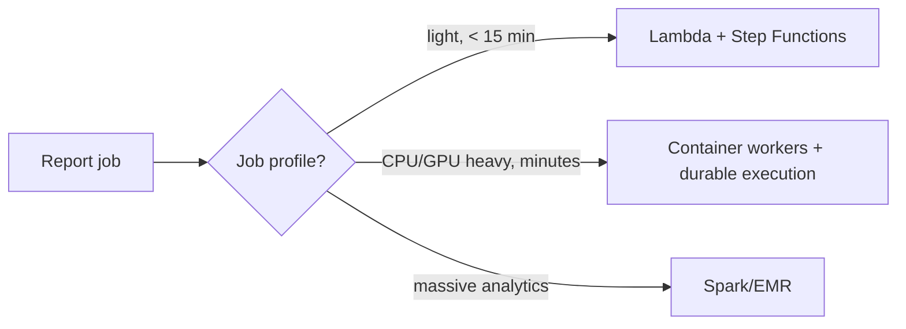

# Alternatives, Other Scenarios & Tradeoffs

The point of this page: show I considered the design space and chose
deliberately. Managers reward tradeoff awareness over cleverness. Each decision
below has a **recommendation** and the condition under which I'd switch.

---

## Decision 1 — Compute runtime for the long-running job

| Option | Pros | Cons | When to pick |
|--------|------|------|--------------|
| **Lambda + Step Functions + SQS** | Scale to zero; fully managed; Distributed Map handles fan-out natively. | **15-min hard cap**; heavy image processing awkward; cost at massive fan-out; /tmp limits. | Reports are light & fast; org is Lambda-first. |
| **Container batch — ECS/Fargate or EKS + SQS** ? | No time limit; right fit for CPU/GPU image work; autoscale on queue depth; spot for cost. | You own scaling/capacity. | **Default** — heavy, minutes-long jobs at scale (my assumption A3). |
| **Durable execution — Temporal / Restate (self-host on EKS)** ? | Per-step persistence ? **resume after crash/deploy**; built-in retries/versioning; superb observability of stuck reports. | You run another stateful system; must model idempotent steps. | When resumability/auditability of long journeys matters — i.e. regulated Florence. |
| **Big-data batch — EMR/Spark/Glue** | Great for *massive* cross-entity analytical aggregation. | Overkill for per-user PDF assembly; heavy op cost; wrong granularity. | If a report is genuinely large-scale analytics, not per-user assembly. |

**Recommendation:** container workers as the substrate, **orchestrated by durable
execution** for the multi-step report workflow. Step Functions is the fully-managed
equivalent if the team prefers no self-hosted engine — but a managed workflow
engine can put state outside the region boundary, which is a residency
consideration for Florence (same reason I self-hosted Restate previously).

---

## Decision 2 — Personalised recompute vs shared aggregation (biggest cost lever)

- **Naive:** every weekly run recomputes each user's aggregation from raw data
  and reprocesses images. Simple, but O(users × history) work every week — this
  is what melts the DB and the budget at "very large user base".
- **Recommended (CQRS read model):** maintain **shared study/site aggregates
  incrementally** (fed by change streams / domain events as data lands). The
  weekly report becomes cheap **assembly + personalization + render**, not a full
  recompute. Cache processed images by content hash so identical images aren't
  reprocessed per subscriber.

**Tradeoff:** eventual consistency between source and read model, and more moving
parts. Worth it because read/write shapes diverge sharply and reads dominate —
the exact condition where CQRS earns its keep (and I've run change-streams ?
derived read store in production).

---

## Decision 3 — Email delivery: attach PDF vs secure link

| Option | Pros | Cons |
|--------|------|------|
| **Attach PDF to email** | One click; works offline. | **PHI leaves the boundary** in cleartext transport; email size limits; no access audit; hard to revoke. |
| **Notification + authenticated secure link** ? | No PHI in email; per-access authz + audit; revocable; no size limit; supports residency. | Extra click; user must be logged in. |

**Recommendation:** secure link. In a HIPAA/GxP context this is effectively
non-negotiable, and it makes the "who accessed the report" audit trivial.

---

## Decision 4 — Scheduling model (avoiding the weekly stampede)

| Option | Pros | Cons |
|--------|------|------|
| **Single global weekly cron** | Dead simple. | Thundering herd: peak = 100% of users at one instant. |
| **Sharded schedule (by day/hour/timezone)** ? | Peak ? average; smooth DB/worker/SES load; aligns "weekly 7am" to the user's timezone. | Slightly more scheduling logic. |
| **Per-user arbitrary schedule** | Max flexibility. | Hardest to reason about capacity; only if the product needs it. |

**Recommendation:** shard by (timezone, dayOfWeek, hour). "Weekly" becomes a
rolling wave across the week, which is what makes "very large user base"
tractable on fixed capacity.

---

## Decision 5 — Transport: SQS vs Kafka

- **SQS (+ SNS/EventBridge):** simplest managed fan-out, native DLQ, visibility
  timeout = free at-least-once + retry semantics. Great default for a work queue.
- **Kafka:** Florence already runs it; better if we want a durable, replayable
  **event log** (e.g. `report.*` events consumed by analytics/TrialFlo too),
  ordering per key, and high sustained throughput.

**Recommendation:** SQS for the *work queue* (backpressure + DLQ are first-class);
Kafka for the *event stream* if these events feed other consumers. Designed
transport-agnostic so either fits. Honest note: I've run RabbitMQ/SQS heavily;
Kafka is the same mental model (partitions ? ordering, consumer groups,
at-least-once) and I'd ramp fast.

---

## Decision 6 — Buy vs build the PDF/reporting

- **Build (headless renderer, e.g. HTML?PDF):** full control over layout, images,
  branding; no PHI leaving to a third party.
- **Buy (managed reporting/BI/PDF SaaS):** faster start, but PHI to a third party
  and less control over image-heavy layouts.

**Recommendation:** build the renderer in-region (PHI + layout control). Buy only
non-PHI infra (SES, KMS, scheduler).

---

## "Other scenarios" the interviewer may throw at me

Prepared extensions — each is a small delta on the same architecture:

1. **"Now make it daily / real-time."** Shorter cron shard interval; the fan-out
   pipeline is unchanged. Real-time ? drop the scheduler, trigger on
   `report.requested` events. The decoupling already supports this.
2. **"A single report is huge / times out."** It's already durable + resumable;
   split the workflow into checkpointed sub-steps; the image step fans out to the
   image pool and fans back in.
3. **"SES is throttling / bouncing."** Delivery plane is separate and throttled to
   quota; DLQ + suppression list + retry with backoff; bounces/complaints via SNS
   feed the suppression list; report generation is unaffected.
4. **"A worker crashes mid-report."** Durable state ? resume from last completed
   step. Idempotency key prevents a duplicate report/email.
5. **"Regulator asks to prove delivery of report X."** Append-only audit:
   generated ? delivered (SES messageId) ? accessed, with timestamps and region.
6. **"EU customer: data can't leave the EU."** Region is a first-class boundary;
   generation + storage + audit are per-region, control plane is global metadata only.
7. **"Costs are too high."** Spot instances for batch, autoscale-to-zero between
   waves, content-hash image cache, shared aggregates instead of recompute.
