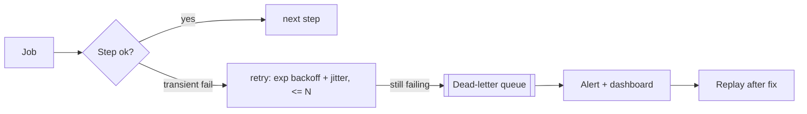

# Reliability, Scale, Security & Compliance

The "adherence to best practices" half of the grade lives here.

---

## Idempotency & delivery semantics

- Transport is **at-least-once** ? every step must be safe to re-run.
- **Idempotency key** `= hash(subscriptionId, period)` with a **unique index** on
  the `reports` collection. First worker to claim it wins; a duplicate message
  finds a `ready` report and no-ops.
- **Email dedup** on `reportId` (+ send attempt) so a re-delivered `report.ready`
  never emails twice.
- Net effect: **effectively-once** outcomes on top of at-least-once plumbing —
  the honest, achievable semantic (no hand-wave about "exactly once").
- Every external side effect (S3 put, SES send) is keyed/deduped so retries after
  a mid-step crash don't double-produce.

## Failure handling

- **Retries:** exponential backoff + jitter, capped attempts.
- **Partial failure isolation:** one report failing never blocks the batch —
  each report is an independent unit of work.
- **DLQ + replay:** poison messages park in a DLQ with full context; replayable
  once the root cause is fixed (idempotency makes replay safe).
- **Resumability:** durable execution restarts a crashed report from the last
  completed step, not from scratch — critical for minutes-long jobs.
- **Poison/oversized inputs:** guardrails on image count/size per report; overflow
  routed to a slow lane rather than killing a worker.

## Scale strategy ("very large user base, used heavily")

| Pressure point | Mitigation |
|----------------|-----------|
| Weekly stampede | **Shard schedule** by timezone/day/hour ? peak ? average. |
| DB hammered by aggregation | **Shared incremental aggregates (CQRS)**; read from read-model, not raw; read replicas. |
| Redundant image work | **Content-hash cache** — process an image once, reuse across subscribers. |
| Worker fleet | **Autoscale on queue depth / consumer lag**; scale to zero between waves; **spot** for batch. |
| Image pool starving orchestration | **Separate autoscaled pool** for CPU/GPU image work. |
| SES quota | Delivery plane **throttled to quota**; queue absorbs the burst; warm-up sending limits. |
| Backpressure | The queue *is* the shock absorber — producers never overrun consumers. |

**Capacity mental model:** if N reports are due in a shard and each takes ~T
worker-seconds, required concurrency ? (N·T)/window. Autoscaling targets a queue
depth that keeps p95 completion within the delivery window; workers scale down
when the wave drains.

## Observability & SLOs

- **Golden metrics:** due-count, enqueued, in-progress, completed, failed, DLQ
  depth, queue lag, p50/p95 generation time (broken down by aggregate/image/render),
  SES bounce & complaint rate, **% delivered within window** (the user-facing SLO).
- **Tracing** across steps via a correlation id = `reportId`.
- **Alerting** on DLQ growth, delivery-SLO breach, bounce-rate spike, worker saturation.
- Because state is persisted per step, "where is report X stuck and why" is a
  lookup, not a log-archaeology exercise.

## Security

- **Encryption:** S3 SSE-KMS at rest; TLS in transit; per-region KMS keys.
- **Least privilege:** workers can read source + write PDFs only for their region;
  API can mint pre-signed URLs but not read PHI in bulk.
- **Access control:** Auth0/JWT on all endpoints; object-level authz on download
  ("does this user own this report?").
- **Pre-signed URLs:** short TTL (~5 min), single object, generated only after authz.
- **No PHI in email or logs;** structured logs scrub PHI fields.

## Compliance — 21 CFR Part 11 / GxP / HIPAA (the Florence lens)

- **Audit trail (append-only, Postgres):** generated ? delivered (SES messageId)
  ? accessed, each with actor, timestamp, region, and the **data version** the
  report was built from. Answers "prove report X was produced from data as of
  date Y and delivered to person Z."
- **Data residency:** generation, storage, and audit are **per-region**; PHI never
  crosses the boundary. Control plane holds only non-PHI metadata.
- **Retention:** S3 lifecycle + Object Lock (WORM) for immutability; retention
  aligned to the study's requirement (Florence advertises up to 25 years).
- **Immutability & versioning:** a delivered report is never mutated; a regenerate
  produces a new versioned instance, old one retained.
- **Right to prove non-delivery too:** bounces/complaints are audited, so a failed
  delivery is on the record, not silently lost.

## Testing & rollout

- **Idempotency tests:** replay the same job/event; assert one report, one email.
- **Load test** a full shard at target volume; verify autoscaling + SLO.
- **Chaos:** kill a worker mid-render; assert resume + no duplicate.
- **Rollout:** feature-flagged; dark-launch to internal users; expand-contract for
  any schema change so blue/green cutover stays backward-compatible.
